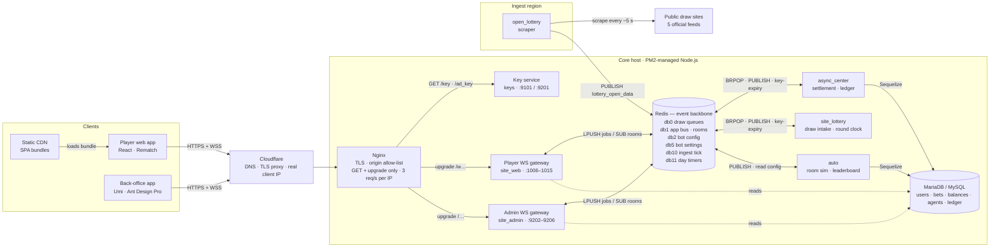

# Lottery Platform — System Design

> [!IMPORTANT]
> **<ins>This is a demo project built to showcase the technology and system design.</ins>**
> It is not affiliated with, endorsed by, or operated for any casino, gambling or lottery business, and it is not intended for real-money use.

A real-time lottery game. Results are scraped from public draw feeds every few seconds, players bet over a single encrypted WebSocket, the platform settles each round automatically, and payouts reach every connected client within the same second. A separate back-office app lets operators manage users, agents, balances and promotions.

| | |
|---|---|
| Services | 8 |
| PM2 processes | 12 |
| Redis | 1 instance, 6 logical DBs |
| System of record | MariaDB / MySQL |
| Games | 5 scraped feeds + 2 house-drawn |

## Tech stack

**Backend**

-010101?style=for-the-badge&logo=socketdotio&logoColor=white)

**Data**

**Frontend**

**Infrastructure**

## Contents

- [Architecture](#architecture)
- [Services](#services)
- [Redis map](#redis-map)
- [Key decisions](#key-decisions)
- [Next iteration](#next-iteration)
- [From the original sketch](#from-the-original-sketch)
- [Repository layout](#repository-layout)

---

## Architecture

The origin never serves files. Bundles come from the CDN, and Nginx admits only two kinds of request: a key fetch and a WebSocket upgrade. Past the gateways, every component talks through Redis and never calls another service directly. The gateways read MariaDB directly for auth and account pages.

---

## Services

| Service | PM2 processes | Responsibility | Talks to |
|---|---|---|---|
| `open_lottery` | `lottery_redis` | Scrapes 5 public draw feeds on a TTL tick, dedupes by period, keeps the daily draw schedule. | Draw sites · Redis db10/11 |
| `site_lottery` | `lottery_in`, `lottery_open`, `lottery_qun` | Turns raw draws into rounds: history, the upcoming four periods, settlement jobs, and room announcements. | Redis db0/1/10 |
| `async_center` | `async_bet_open`, `async_do_dou` | Settles bets. Runs every balance-changing job queued by the gateways: deposits, transfers, rebates, bonuses, agent payouts. | Redis db0/1/2/5 · MariaDB |
| `site_web` | `web` | Player WebSocket gateway. Routes `controller/action` messages, serves reads directly, and queues writes. | Redis db1 · MariaDB |
| `site_admin` | `web_backoffice_admin` | Back-office gateway: users, agents, odds and limits, top-ups, reports, live traffic view. | Redis · MariaDB · TRON API |
| `keys` | `web_keys`, `web_keys_admin` | Issues short-lived signed connection URLs for players and admins. | none (stateless) |
| `auto` | `auto_bet`, `auto_phb` | Seeds demo room activity and runs the scheduled leaderboard. | Redis db0/1/2 · MariaDB |
| `nginx` | n/a | TLS, origin allow-list, method and user-agent filtering, per-IP rate limit, load balancing across gateway ports. | keys · gateways |
| `site_UI_desktop`, `site_UI_admin` | static build | Player SPA (CRA + Rematch, i18n) and back-office SPA (Umi + Ant Design Pro). | CDN → WSS only |

---

## Redis map

Redis carries every cross-service interaction in four patterns: lists as work queues, pub/sub for fan-out, expiring keys as timers, and plain keys for shared config.

| DB | Pattern | Keys and channels | Purpose |
|---|---|---|---|
| db0 | queue · list · timer | `lottery_open_list`, `bet_open_list`, `lottery_list_*`, `lottery_fou_*`, `gqabs_*` | Draw intake queue, settlement queue, per-game history, round close timers. |
| db1 | queue · pub/sub · config | `sub_do_list`, `request_view_data`, `user-room`, `site-room`, `admin-*`, `GameSet` | Application bus: write jobs from gateways, result fan-out, admin live feed, game settings. |
| db2 | config | `auto_config` | Room-simulation and auto-bet settings. |
| db5 | config | bot keys | Messaging-bot settings (outside this project's scope). |
| db10 | timer · pub/sub · state | `run_get_number`, `game_list_*`, `lottery_open_data` | Scraper tick, last seen period per game, new-draw channel. |
| db11 | timer | `day_*` | Scheduled draw times, so rounds advance even before a feed publishes. |

---

## Key decisions

**Redis as the only integration point.**
Services never call each other. They push to a list, publish to a channel, or set a key.
*Why:* any worker can restart without the others noticing, and adding a game means adding a scraper and a settlement rule, not a new API.

**Writes through a queue, reads direct.**
Gateways read MariaDB for pages but hand every balance change to `async_center` via `sub_do_list`.
*Why:* one consumer applies money movements in order, so two simultaneous bets from one user cannot race on the same balance.

**One socket per client.**
Requests, responses and server push share a single WebSocket, with path-style routing.
*Why:* live odds, countdowns and payouts need push anyway. Running everything over one channel removes a second protocol and its auth.

**Stateless gateways behind signed URLs.**
The key service signs a timestamp and nonce; the gateway decrypts it and derives the connection key.
*Why:* no sticky sessions or shared session store. Nginx spreads upgrades across ports freely.

**Ingest isolated from the player host.**
The scraper originally ran in a separate AWS region and replicated draws into the core Redis.
*Why:* scraping traffic, its IP reputation and its failures never touch the host players connect to.

**Static front ends off the origin.**
Both SPAs ship from object storage and a CDN.
*Why:* the origin's attack surface is two URL shapes. Nginx returns 404 for everything else.

---

## Next iteration

The design holds up. These are the changes that would take it from a working demo to something you would run with real balances, ordered by impact.

| Area | Change | Reason |
|---|---|---|
| Correctness | **Idempotent settlement.** Record a settlement row per (game, period) under a unique key, and apply all of a round's bet updates and balance changes in one database transaction. | Today a crash halfway through a round leaves some bets settled and the job gone from the list. |
| Reliability | **Redis Streams instead of lists and expiry events.** Move queues to Streams with consumer groups and acknowledgements. Move timers to delayed jobs (BullMQ or a sorted set). | BRPOP removes a job before it is processed, and keyspace notifications are fire-and-forget: a subscriber that is down misses the tick. |
| Security | **Real session auth over TLS.** Replace the XOR frame masking with a signed session token (HMAC or JWT) checked at upgrade, and rely on WSS for confidentiality. Drop TLS 1.0 and 1.1 at Nginx. | Masking hides traffic from casual inspection but is not encryption. The key derivation runs in the browser, where anyone can read it. |
| Security | **Secrets out of the source tree.** Signing keys, database credentials, bot tokens and the TLS private key go into environment variables or a secret manager. | Anyone with the repository has them. |
| Scale | **Gateways as processes, not ports.** Run the player gateway as a PM2 cluster and make the Nginx upstream list match it. | Ten ports in one Node process still run on one CPU core. |
| Operations | **Split Redis by role, add visibility.** Separate instances for durable queues (AOF on) and for cache and pub/sub. Export queue depth, settlement latency per round and scraper freshness per feed. | Six logical DBs share one memory limit, one persistence policy and one failure. |

---

## From the original sketch

**Kept**

- Separate scraper host feeding the core through Redis
- Single core host running Nginx, Node services under PM2, MySQL and Redis
- Static assets on object storage and a CDN, with Cloudflare in front
- The four core processes: Keys, Site (Web), Site (Admin), Async Center

**Changed**

- Drawn by data flow rather than by vendor, so the arrows show what moves
- Added the draw pipeline (`site_lottery`) and the `auto` jobs, which the sketch folded into "Lottery Website"
- Redis drawn as the backbone with its DB map, not as a replica icon
- Regulatory and hosting-registration notes, staffing and messaging integrations left out of scope

---

## Repository layout

| Folder | Role |
|---|---|
| `frontend_web` | Player web app (React) |
| `frontend_admin` | Back-office app (Umi · Ant Design Pro) |
| `backend_web` | Player WebSocket gateway |
| `backend_admin` | Admin WebSocket gateway |
| `backend_keys` | Issues connection keys for both gateways |
| `backend_lottery` | Draw intake and round clock |
| `backend_async_center` | Bet settlement and balance ledger |
| `backend_automation` | Room simulation and leaderboard jobs |
| `api_lottery` | Scrapers for the public draw feeds |
| `backend_nginx` | Nginx config in front of the gateways |
| `docs` | Earlier design write-ups |
