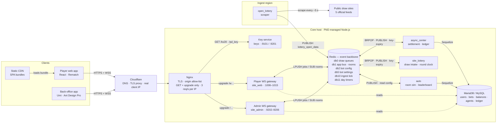
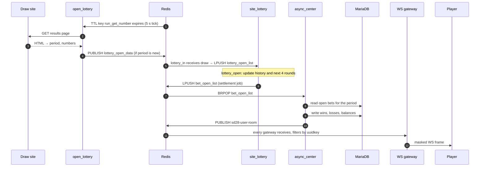
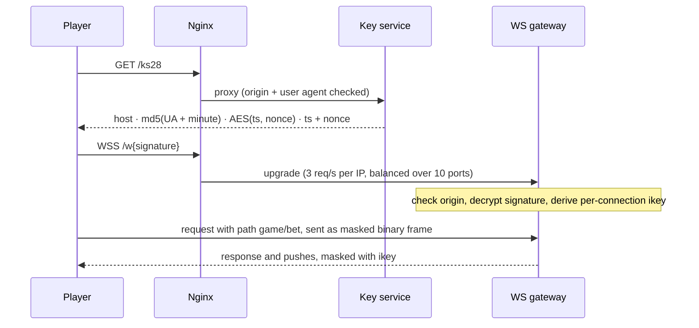

# KS28 Lottery Platform — System Design

> Demo project 01 · derived from the `ks-lottery` source, November 2026

A real-time "28"-style lottery game. Results are scraped from public draw feeds every few seconds, players bet over a single encrypted WebSocket, the platform settles each round automatically, and payouts reach every connected client within the same second.

| | |
|---|---|
| Services | 8 |
| PM2 processes | 12 |
| Redis | 1 instance, 6 logical DBs |
| System of record | MariaDB / MySQL |
| Games | 5 scraped feeds + 2 house-drawn |
| Stack | Node.js · Express · ws · Sequelize · React · Umi / Ant Design Pro |

## Contents

- [Architecture](#architecture)
- [A round, from draw to payout](#a-round-from-draw-to-payout)
- [Connecting a client](#connecting-a-client)
- [Services](#services)
- [Redis map](#redis-map)
- [Key decisions](#key-decisions)
- [Next iteration](#next-iteration)
- [From the original sketch](#from-the-original-sketch)

---

## Architecture

The origin never serves files. Bundles come from the CDN, and Nginx admits only two kinds of request: a key fetch and a WebSocket upgrade. Past the gateways, every component talks through Redis and never calls another service directly. The gateways read MariaDB directly for auth and account pages.

---

## A round, from draw to payout

No service waits on another: every hop is either a queue pop or a pub/sub message, so a slow settlement never blocks draw intake.

1. **Tick.** The scraper holds no cron. It sets `run_get_number` with a 5-second TTL, and Redis keyspace notifications (`__keyevent@10__:expired`) wake it up. The same trick, on db11, fires a timer at each game's scheduled draw time.
2. **Fetch and dedupe.** Each feed is parsed with cheerio. A draw is new only if its period number is greater than `game_list_{game}`, so repeated scrapes are harmless.
3. **Record the round.** `lottery_in` receives the draw and queues it. `lottery_open` pops it, updates history and the next four rounds' bet slips, and pushes a settlement job. `lottery_qun` uses expiring keys to announce "betting closed" to each game room before the draw.
4. **Settle.** `bet_open` loads every open bet for that period, evaluates each one against the result with the current odds and the per-round payout cap (`GameSet.max-open`), then writes wins, losses and balance changes.
5. **Push.** Results go out on `sd28-user-room`. Every gateway process is subscribed and forwards a message only to the socket whose `uuidkey` matches. Room-wide events (new draw, countdown) go on `sd28-site-room` to everyone.

---

## Connecting a client

No session cookie and no REST API. A client asks for a short-lived signed URL, opens one WebSocket with it, and then sends every request as a `controller/action` message on that socket.

The key service and the gateways share the AES key, so the gateways stay stateless. Any gateway process can accept any client, and nothing about the handshake is stored. Admin traffic uses the same flow on its own hostnames and keys (`/ad_key`, ports 9202–9206).

---

## Services

| Service | PM2 processes | Responsibility | Talks to |
|---|---|---|---|
| `open_lottery` | `lottery_redis` | Scrapes 5 public draw feeds on a TTL tick, dedupes by period, keeps the daily draw schedule. | Draw sites · Redis db10/11 |
| `site_lottery` | `lottery_in`, `lottery_open`, `lottery_qun` | Turns raw draws into rounds: history, the upcoming four periods, settlement jobs, and room announcements. | Redis db0/1/10 |
| `async_center` | `async_bet_open`, `async_do_dou` | Settles bets. Runs every balance-changing job queued by the gateways: deposits, transfers, rebates, bonuses, agent payouts. | Redis db0/1/2/5 · MariaDB |
| `site_web` | `web` | Player WebSocket gateway. Routes `controller/action` messages, serves reads directly, and queues writes. | Redis db1 · MariaDB |
| `site_admin` | `web_backoffice_admin` | Back-office gateway: users, agents, odds and limits, top-ups, reports, live traffic view. | Redis · MariaDB · TRON API |
| `keys` | `web_keys`, `web_keys_admin` | Issues short-lived signed connection URLs for players and admins. | none (stateless) |
| `auto` | `auto_bet`, `auto_phb` | Seeds demo room activity and runs the scheduled leaderboard. | Redis db0/1/2 · MariaDB |
| `nginx` | n/a | TLS, origin allow-list, method and user-agent filtering, per-IP rate limit, load balancing across gateway ports. | keys · gateways |
| `site_UI_desktop`, `site_UI_admin` | static build | Player SPA (CRA + Rematch, i18n) and back-office SPA (Umi + Ant Design Pro). | CDN → WSS only |

---

## Redis map

Redis carries every cross-service interaction in four patterns: lists as work queues, pub/sub for fan-out, expiring keys as timers, and plain keys for shared config.

| DB | Pattern | Keys and channels | Purpose |
|---|---|---|---|
| db0 | queue · list · timer | `lottery_open_list`, `bet_open_list`, `lottery_list_*`, `lottery_fou_*`, `gqabs_*` | Draw intake queue, settlement queue, per-game history, round close timers. |
| db1 | queue · pub/sub · config | `sd28_sub_do_list`, `sd28_request_view_data`, `sd28-user-room`, `sd28-site-room`, `sd28-admin-*`, `GameSet` | Application bus: write jobs from gateways, result fan-out, admin live feed, game settings. |
| db2 | config | `ks28_auto` | Room-simulation and auto-bet settings. |
| db5 | config | bot keys | Messaging-bot settings (outside this project's scope). |
| db10 | timer · pub/sub · state | `run_get_number`, `game_list_*`, `lottery_open_data` | Scraper tick, last seen period per game, new-draw channel. |
| db11 | timer | `day_*` | Scheduled draw times, so rounds advance even before a feed publishes. |

---

## Key decisions

**Redis as the only integration point.**
Services never call each other. They push to a list, publish to a channel, or set a key.
*Why:* any worker can restart without the others noticing, and adding a game means adding a scraper and a settlement rule, not a new API.

**Writes through a queue, reads direct.**
Gateways read MariaDB for pages but hand every balance change to `async_center` via `sd28_sub_do_list`.
*Why:* one consumer applies money movements in order, so two simultaneous bets from one user cannot race on the same balance.

**One socket per client.**
Requests, responses and server push share a single WebSocket, with path-style routing.
*Why:* live odds, countdowns and payouts need push anyway. Running everything over one channel removes a second protocol and its auth.

**Stateless gateways behind signed URLs.**
The key service signs a timestamp and nonce; the gateway decrypts it and derives the connection key.
*Why:* no sticky sessions or shared session store. Nginx spreads upgrades across ports freely.

**Ingest isolated from the player host.**
The scraper originally ran in a separate AWS region and replicated draws into the core Redis.
*Why:* scraping traffic, its IP reputation and its failures never touch the host players connect to.

**Static front ends off the origin.**
Both SPAs ship from object storage and a CDN.
*Why:* the origin's attack surface is two URL shapes. Nginx returns 404 for everything else.

---

## Next iteration

The design holds up. These are the changes that would take it from a working demo to something you would run with real balances, ordered by impact.

| Area | Change | Reason |
|---|---|---|
| Correctness | **Idempotent settlement.** Record a settlement row per (game, period) under a unique key, and apply all of a round's bet updates and balance changes in one database transaction. | Today a crash halfway through a round leaves some bets settled and the job gone from the list. |
| Reliability | **Redis Streams instead of lists and expiry events.** Move queues to Streams with consumer groups and acknowledgements. Move timers to delayed jobs (BullMQ or a sorted set). | BRPOP removes a job before it is processed, and keyspace notifications are fire-and-forget: a subscriber that is down misses the tick. |
| Security | **Real session auth over TLS.** Replace the XOR frame masking with a signed session token (HMAC or JWT) checked at upgrade, and rely on WSS for confidentiality. Drop TLS 1.0 and 1.1 at Nginx. | Masking hides traffic from casual inspection but is not encryption. The key derivation runs in the browser, where anyone can read it. |
| Security | **Secrets out of the source tree.** Signing keys, database credentials, bot tokens and the TLS private key go into environment variables or a secret manager. | Anyone with the repository has them. |
| Scale | **Gateways as processes, not ports.** Run the player gateway as a PM2 cluster and make the Nginx upstream list match it. | Ten ports in one Node process still run on one CPU core. |
| Operations | **Split Redis by role, add visibility.** Separate instances for durable queues (AOF on) and for cache and pub/sub. Export queue depth, settlement latency per round and scraper freshness per feed. | Six logical DBs share one memory limit, one persistence policy and one failure. |

---

## From the original sketch

**Kept**

- Separate scraper host feeding the core through Redis
- Single core host running Nginx, Node services under PM2, MySQL and Redis
- Static assets on object storage and a CDN, with Cloudflare in front
- The four core processes: Keys, Site (Web), Site (Admin), Async Center

**Changed**

- Drawn by data flow rather than by vendor, so the arrows show what moves
- Added the draw pipeline (`site_lottery`) and the `auto` jobs, which the sketch folded into "Lottery Website"
- Redis drawn as the backbone with its DB map, not as a replica icon
- Regulatory and hosting-registration notes, staffing and messaging integrations left out of scope
